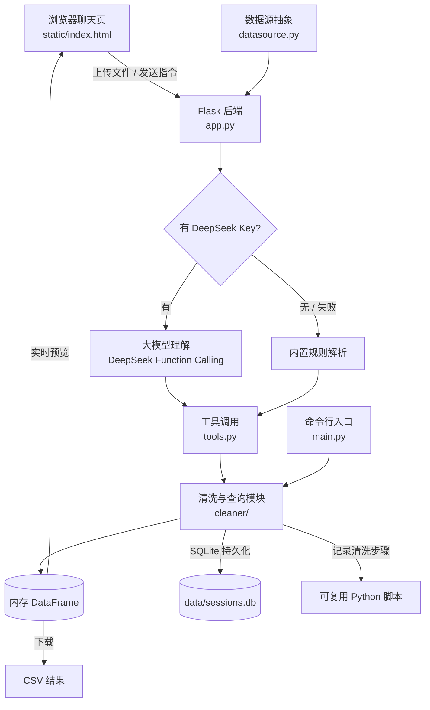

# 数据清洗自动化小项目（最小闭环）

这是一个「数据清洗 + 自动化脚本」项目，当前已实现：

> 原始数据 -> 清洗 -> 查询/筛选 -> 输出结果 -> 打印报告

后续可以在这条闭环上继续叠加更多功能（多格式、定时任务、文件监听、规则化配置等）。

提供两种使用方式：
- **命令行**：`python main.py`（适合脚本/自动化）
- **网页聊天**：`python app.py`，浏览器导入数据后用对话清洗（见下文）

## 架构



## 目录结构

```
data-cleaning-project/
├── main.py               # 入口脚本
├── app.py                # 网页聊天版后端（Flask）
├── datasource.py         # 数据源抽象（CSV/Excel/JSON）
├── store.py              # SQLite 会话持久化
├── tools.py              # Function Calling 工具定义与执行
├── config.yaml           # 清洗规则配置
├── requirements.txt      # 依赖清单
├── Dockerfile            # 容器镜像
├── docker-compose.yml    # 容器编排
├── conftest.py           # pytest 公共配置
├── pytest.ini            # pytest 配置
├── cleaner/
│   ├── __init__.py
│   ├── config.py         # 读取配置
│   ├── pipeline.py       # 清洗流水线
│   └── query.py          # 查询/筛选
├── static/
│   └── index.html        # 网页聊天前端
├── tests/
│   ├── test_pipeline.py  # 清洗流水线测试
│   ├── test_query.py     # 查询筛选测试
│   ├── test_app.py       # 网页后端 + 工具测试
│   └── test_store.py     # SQLite 持久化测试
└── data/
    ├── raw/sample.csv    # 示例原始数据（含脏数据）
    └── clean/            # 清洗结果输出目录（脚本自动生成）
```

## 网页聊天版

```bash
python app.py
```

浏览器打开 http://127.0.0.1:5000 ，然后：
1. 点右上角「导入数据」上传 CSV 或 Excel；
2. 在对话框用自然语言下指令，例如：
   - `找出2026.10.6的数据`
   - `删除重复行` / `去掉空格` / `删除空值` / `把空值填成0`
   - `目的城市=上海` / `状态是已签收`
   - `重量大于10` / `重量在5到10之间`
   - `每个城市有多少单` / `按城市统计平均重量` / `按城市统计运费总和`
   - `只看城市和重量` / `删除运单号列`
   - `按重量从大到小排序` / `前10行` / `数据概况`
3. 右侧实时预览结果，点「下载结果」保存当前数据。

> 网页版内置的对话理解是规则匹配，不依赖外部大模型，离线可用；
> 需要的话后续可替换为真正的 LLM 接口。

### 大模型模式（推荐，需要 DeepSeek Key）

如果设置了 `DEEPSEEK_API_KEY`（或项目目录下有 `deepseek_key.txt`），
网页版会自动用 DeepSeek 大模型来理解你的自然语言，几乎任何说法都能听懂；
没有 key 时则退回内置规则，离线也能用。

```powershell
# 当前会话临时设置（换成你自己的 key）
$env:DEEPSEEK_API_KEY="sk-你的key"
python app.py
```

也可以把 key 写进项目根目录的 `deepseek_key.txt`（一行纯文本，注意不要提交到公开仓库）。

如果 5000 端口被占用，换一个端口启动：

```powershell
$env:PORT="5001"
python app.py
```

### 多轮对话 & 导出脚本

- 支持多轮上下文：例如先说“把重量超过20的找出来”，再说“再按运费从大到小排序”，
  助手会接着上一步的结果继续处理。
- 右上角「导出脚本」按钮，或直接说“导出脚本”，可下载一个可复用的 Python 脚本，
  脚本里包含基础预处理和你刚才做的每一步清洗，换一份数据也能直接复用。

### 进阶能力

- **Function Calling**：大模型通过调用 `tools.py` 里定义的工具（筛选、排序、分组、清洗等）
  来操作数据，而不是直接生成代码，更安全、可控。
- **SQLite 持久化**：会话、对话历史与清洗步骤落库到 `data/sessions.db`，重启不丢失；
  `GET /api/sessions` 可查看历史会话。
- **数据源抽象**：`datasource.py` 统一 CSV / Excel / JSON 的读取与中文编码兼容，
  新增数据源只需加一个分支。

## 快速开始

```bash
python main.py
```

运行后会读取 `config.yaml` 里 `source` 指定的文件（当前是 `data/raw/logistics.csv`），
执行清洗和查询，并把结果写到 `data/clean/cleaned.csv`。

### 查询 / 筛选用法

```bash
# 按某一天筛选（日期写法不敏感：2026.10.6 / 2026-10-6 / 2026/10/6 均可）
python main.py --date 2026.10.6

# 按时间段筛选（闭区间）
python main.py --start 2026.10.1 --end 2026.10.31

# 指定日期列（默认取 config.yaml 里的 query.date_column）
python main.py --date 2026.10.6 --date-column 签收时间

# 按任意列精确匹配（可重复多个条件）
python main.py --where 城市=上海 --where 状态=已签收

# 自定义输出文件名
python main.py --date 2026.10.6 --out result_1006.csv
```

> 提示：`--where` 和 `--date-column` 里的列名，请使用清洗后的标准列名
> （即去掉了空格、统一为下划线的列名）。

## 当前内置的清洗规则

- 列名标准化（去空格、转小写、空格转下划线）
- 文本首尾空格清理
- 空白字符串统一转换为缺失值
- 数值型字符串自动转换（如 "12.5" -> 12.5）
- 去除完全重复的行
- 缺失值处理（删除整行 或 用固定值填充）
- 日期列标准化（支持 2024/03/01 与 2024-03-02 混用，可选开启）
- 查询/筛选（按日期、时间段、任意列精确匹配）

## 如何扩展

1. 在 `config.yaml` 里调整规则开关；
2. 在 `cleaner/pipeline.py` 的 `clean()` 里新增清洗步骤；
3. 把 `source` 换成你自己的数据文件即可复用整条链路。

## Docker 部署

```bash
# 方式一：docker-compose（推荐）
docker compose up -d --build

# 方式二：手动构建运行
docker build -t data-cleaning .
docker run -d -p 5000:5000 -e DEEPSEEK_API_KEY="sk-你的key" -v ${PWD}/data:/app/data data-cleaning
```

浏览器打开 http://localhost:5000 。`data/` 目录通过卷挂载，`sessions.db` 会持久化保存。

## 运行测试

```bash
pip install pytest   # 首次需要
pytest -q            # 在项目根目录运行
```

测试覆盖清洗流水线（`pipeline.py`）、查询筛选（`query.py`）和网页后端辅助函数（`app.py`）。
